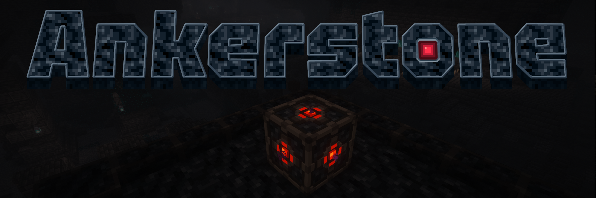
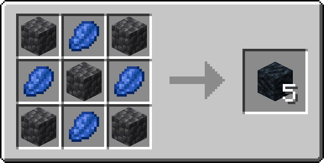
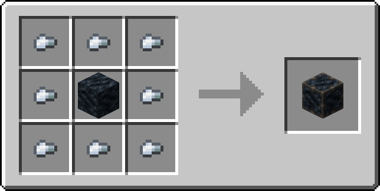
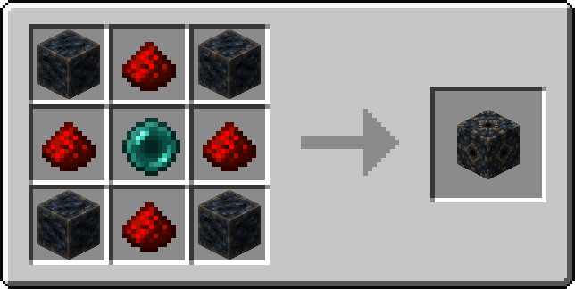

An immersive, vanilla-friendly Fabric mod featuring a redstone-controlled chunk loader, plus Stillstone and Reinforced Stillstone building blocks.

Ankerstone 1.0.0 is available for Minecraft Java Edition 26.1.2, 26.2, and 26.3.

##  Chunk Anchoring

Place an Ankerstone and supply redstone power to keep chunks ticking without a player nearby. Ankerstone uses Minecraft's normal chunk-ticket system, not a simulated player.

| Mode | Redstone Input | Entity-Ticking Coverage | Comparator Output | Piston Movable |
|---|---|---|---|---|
| Off | 0 | None | 0 | Yes |
| Single | 1–14 | 1 chunk | 7 | No |
| Wide | 15 | 3×3 chunks | 15 | No |

Single keeps the chunk containing the Ankerstone entity-ticking. Wide keeps a 3×3 area entity-ticking, centered on that chunk, matching a portal chunk loader's entity-ticking coverage. Vanilla chunk loading also maintains supporting outer rings beyond these areas.

Both modes work in the Overworld, Nether, and End, but affect only the dimension where the Ankerstone is placed. Loading chunks in another dimension requires a separate Ankerstone there.

Turning off the power releases the chunks. Active Ankerstones resume chunk loading automatically after a server restart.

### Vanilla Ticking Rules

**Note:** Keeping chunks ticking does not satisfy mechanics that explicitly require a nearby player:

| Mechanic | What to Expect |
|---|---|
| Redstone circuits, furnaces, and hoppers | Can continue under normal vanilla ticking rules. Keep all required parts of the machine inside the appropriate ticking area. |
| Existing entities, including dropped items | Continue ticking inside the entity-ticking footprint. Ankerstone does not disable normal item aging or mob despawn rules. |
| Natural mob spawning | An Ankerstone does not substitute for the nearby player required by ordinary natural-spawning rules. |
| Standard monster spawners | Still require a nearby player to activate. Loading the chunk alone is not enough. |
| Crops and other random-tick mechanics | Follow the target Minecraft version's vanilla random-tick rules. Ankerstone adds no separate growth system. |
| A paused or closed world/server | Does not run. |

## 🧱 Building With Stillstone

- Stillstone and Reinforced Stillstone each include full blocks, slabs, stairs, and walls.
- Stillstone full blocks do not conduct redstone power. Reinforced Stillstone full blocks use normal solid-block conduction. Slabs, stairs, and walls follow ordinary Minecraft rules for their shapes.

| Block | Minimum Pickaxe to Harvest |
|---|---|
| Stillstone | Any pickaxe |
| Reinforced Stillstone | Iron or better |
| Ankerstone | Iron or better |

## 🔨 Crafting

All recipes have recipe-book unlocks.

Both building-block families have crafting recipes for slabs, stairs, and walls. Their full blocks can also be cut into those shapes with a stonecutter.

| Result | Ingredients and Arrangement | Output |
|---|---|---|
| Stillstone | Five cobbled deepslate and four lapis lazuli in a checkerboard, with deepslate in the corners and center | 5 |
| Reinforced Stillstone | One Stillstone surrounded by eight iron nuggets | 1 |
| Ankerstone | Four Reinforced Stillstone in the corners, four redstone dust along the sides, and an ender pearl in the center | 1 |

## 📜 A Little Lore

Stillstone is deepslate altered with lapis to resist dimensional flux. Ironwork turns that resistance into a structure capable of containing the dimensional energies of an ender pearl. Redstone controls the finished Ankerstone.

Read the full [Lore](https://github.com/Omegaplex/ankerstone/blob/main/docs/lore.md).

### Advancements

Ankerstone has its own advancement tab. Activation credit goes to the player who placed the block, even if someone else powers it. If the placer is offline, they receive credit when they return.

Read [Advancement Notes](https://github.com/Omegaplex/ankerstone/blob/main/docs/advancements.md) for more.

## 📦 Requirements

| Minecraft Java Edition | Minimum Fabric Loader | Minimum Fabric API |
|---|---|---|
| 26.1.2 | 0.19.2 | 0.149.0 for 26.1.2 |
| 26.2 | 0.20.1 | 0.161.0 for 26.2 |
| 26.3 | 0.20.1 | 0.165.0 for 26.3 |

- All three releases require Java 25 or later.
- For multiplayer, install Ankerstone and Fabric API on both the client and server.
- On dedicated servers, set `pause-when-empty-seconds=0` in `server.properties` if Ankerstones should keep ticking with nobody connected. **Ankerstone does not override whole-server pausing**.

## ✨ Shaders

- Tested with [Iris Shaders](https://modrinth.com/mod/iris) and [Complementary Reimagined](https://modrinth.com/shader/complementary-reimagined).
- LabPBR material maps are included for compatible shaders. No additional PBR resource pack is needed for Ankerstone’s blocks.

## 🛠️ Development

See [Testing](https://github.com/Omegaplex/ankerstone/blob/main/docs/testing.md) for automated server coverage and the manual client checklist.

### Upcoming Features

- **Active Ankerstone Limit (1.1.0):** Server administrators will be able to set a world-wide limit on active Ankerstones across all dimensions. Existing Ankerstones remain active if the limit is lowered, while new activations are blocked until capacity becomes available.
- **Mod Menu Config:** customize Ankerstone visual effects and special interactions.
- **Sounds:** custom block sounds and Ankerstone activation sounds.
- **Ankerstone Containment Failure:** When an active Ankerstone is destroyed by an explosion, its contained energy is released, triggering a secondary explosion.

## ⚖️ License

- Code: [Mozilla Public License 2.0](https://www.mozilla.org/MPL/2.0/).
- Original textures and artwork: [Creative Commons Attribution-ShareAlike 4.0](https://creativecommons.org/licenses/by-sa/4.0/).
- See [NOTICE](https://github.com/Omegaplex/ankerstone/blob/main/NOTICE) for artwork credits and license scope.

## 🤖 Development Disclosure

Generative AI was used during development to help write code, tests, and documentation.
