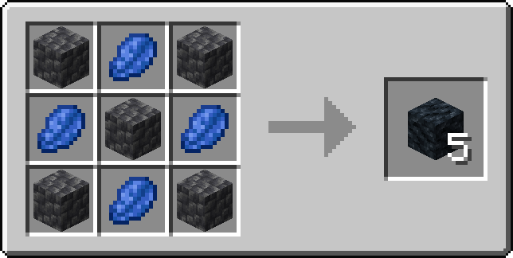
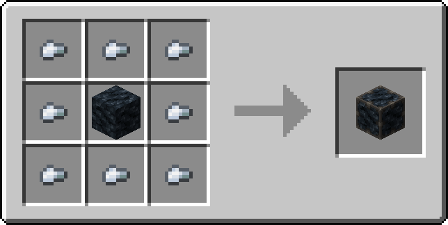
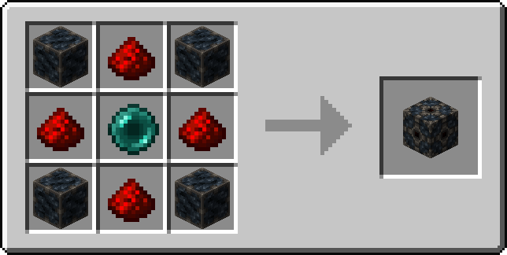

# Ankerstone

A Fabric mod with redstone-controlled chunk anchors, plus Stillstone and Reinforced Stillstone blocks for building.

Ankerstone 1.0.0 is available for Minecraft Java Edition 26.1.2, 26.2, and 26.3.
[Releases](https://github.com/Omegaplex/ankerstone/releases)

## Chunk Anchoring

Place an Ankerstone and supply redstone power to keep chunks active without a player nearby.

| Mode | Redstone Input | Entity-Ticking Coverage | Comparator Output | Piston Movable |
|---|---|---|---|---|
| Off | 0 | None | 0 | Yes |
| Single | 1–14 | 1 chunk | 7 | No |
| Wide | 15 | 3×3 chunks | 15 | No |

Single keeps the chunk containing the Ankerstone entity-ticking. Wide keeps a 3×3 area entity-ticking, centered on that chunk, matching a portal chunk loader's entity-ticking coverage. Vanilla chunk loading also maintains supporting outer rings beyond these areas.

Both modes work in the Overworld, Nether, and End, but affect only the dimension where the Ankerstone is placed. Loading chunks in another dimension requires a separate anchor there.

Turning off the power releases the anchor. Active Ankerstones resume chunk loading automatically after a server restart.

Ankerstone has its own advancement tab. Activation credit goes to the player who placed the block, even if someone else powers it. If the placer is offline, they receive credit when they return.

## Building Blocks

- Stillstone and Reinforced Stillstone each include full blocks, slabs, stairs, and walls.

- Stillstone full blocks do not conduct redstone power. Reinforced Stillstone full blocks use normal solid-block conduction. Slabs, stairs, and walls follow ordinary Minecraft rules for their shapes.
- Tool requirements:  Stillstone; any pickaxe. Reinforced Stillstone and Ankerstone; iron or better.

## Crafting

All recipes have recipe-book unlocks.

Both building-block families have crafting recipes for slabs, stairs, and walls. Their full blocks can also be cut into those shapes with a stonecutter.

## A Little Lore

Stillstone is deepslate altered with lapis to resist dimensional flux. Ironwork turns that resistance into a structure capable of containing the dimensional energies of an ender pearl. Redstone controls the finished Ankerstone.

Read the [lore](docs/lore.md) and [advancement notes](docs/advancements.md) for more.

## Requirements

| Minecraft Java Edition | Ankerstone JAR | Minimum Fabric Loader | Minimum Fabric API |
|---|---|---|---|
| 26.1.2 | `ankerstone-1.0.0+mc26.1.2.jar` | 0.19.2 | 0.149.0 for 26.1.2 |
| 26.2 | `ankerstone-1.0.0+mc26.2.jar` | 0.20.1 | 0.161.0 for 26.2 |
| 26.3 | `ankerstone-1.0.0+mc26.3.jar` | 0.20.1 | 0.165.0 for 26.3 |

- All three releases require Java 25 or later. 

- For multiplayer, install Ankerstone and Fabric API on both the client and server.

- On dedicated servers, set `pause-when-empty-seconds=0` in `server.properties` if anchors should keep ticking with nobody connected. **Ankerstone does not override whole-server pausing**.

## Shaders

- Tested with Iris shader mod.
- LabPBR material maps are included for compatible shaders. No additional PBR resource pack is needed for Ankerstone’s blocks.
- For recessed surfaces, enable LabPBR support and Parallax Occlusion Mapping (POM) in your shader settings.
- An optional **Ankerstone POM Compatibility** pack is available in Minecraft’s Resource Packs menu. It adjusts Wide’s glowing overlay so it does not float above the recessed surface. Disable the POM compatibility pack when playing without LabPBR shaders. The pack starts disabled.

## Development

See [Testing](docs/testing.md) for automated server coverage and the manual client checklist.

## License

- Code: [Mozilla Public License 2.0](https://www.mozilla.org/MPL/2.0/).
- Original textures and artwork: [Creative Commons Attribution-ShareAlike 4.0](https://creativecommons.org/licenses/by-sa/4.0/).
- See [NOTICE](NOTICE) for artwork credits and license scope.

## Development Disclosure

Generative AI was used during development to help write code, tests, and documentation.